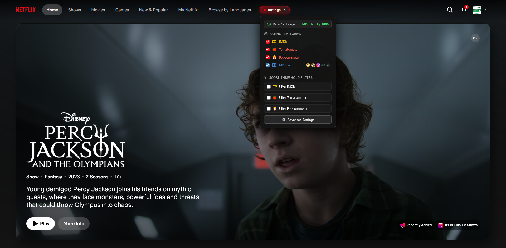
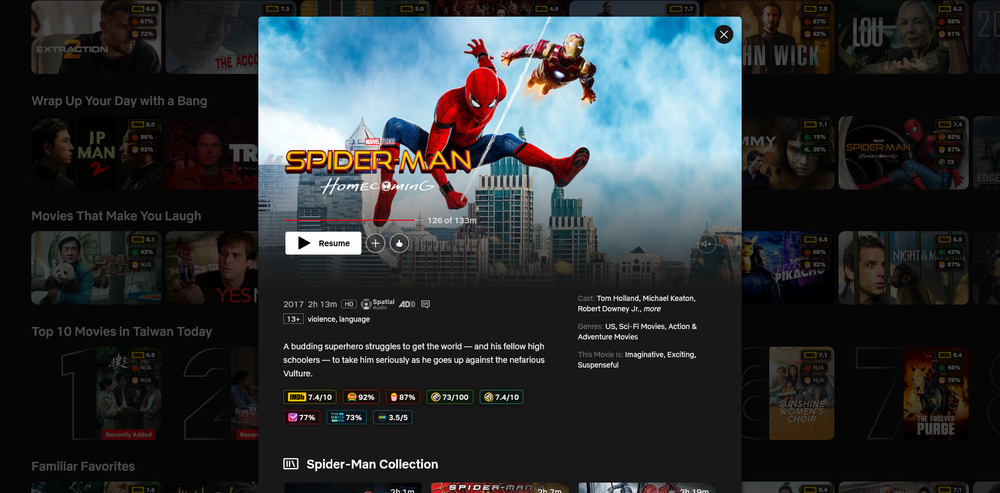
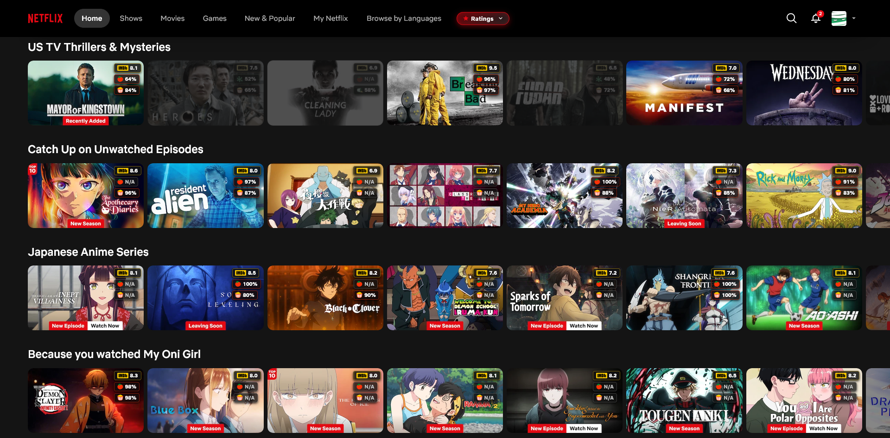
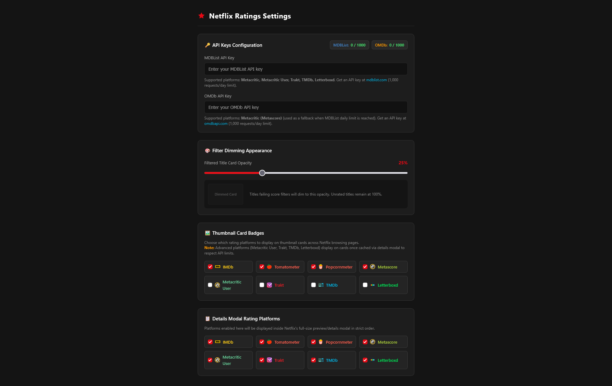

# Netflix Ratings

## About
Displays IMDb, Rotten Tomatoes, Metacritic, Trakt, TMDb, and Letterboxd ratings directly on the Netflix web interface.

Ratings are sourced from:
- [IMDb (Internet Movie Database)](https://www.imdb.com/)
- [Rotten Tomatoes (Tomatometer & Popcornmeter)](https://www.rottentomatoes.com/)
- [Metacritic (Metascore & User Reviews)](https://www.metacritic.com/)
- [Trakt](https://trakt.tv/)
- [TMDb (The Movie Database)](https://www.themoviedb.org/)
- [Letterboxd](https://letterboxd.com/)

## Screenshots

| Browse View | Details Modal |
| :---: | :---: |
|  |  |

| Rating Filter & Dimming | Settings & Options |
| :---: | :---: |
|  |  |


## Features

- **Thumbnail Card Badges**: Overlays rating scores directly onto movie and TV show browsing cards.
- **Detailed Modal Ratings**: Displays multi-platform rating breakdowns inside Netflix's expanded details modal.
- **Rating Filtering & Dimming**: Configurable minimum rating thresholds that dim titles failing your criteria so high-quality titles stand out.
- **Quick Controls & Options**: Customize enabled platforms and dim opacity via the on-page overlay, extension popup, or dedicated options page.
- **Dual API Architecture & Usage Estimates**: Integrates with MDBList (primary) and OMDb (fallback), with local request estimates and quota exhaustion detected from API responses.
- **Cross-Browser Support**: Compatible with Google Chrome (Manifest V3 service worker) and Mozilla Firefox (Manifest V3 scripts).

## Build

Prerequisites: [Node.js](https://nodejs.org/) (v16+) and npm.

```bash
# Install dependencies
npm install

# Build bundles and package zips for Chrome and Firefox
npm run build

# Watch mode for continuous development
npm run watch
```

Building produces compiled bundles in the `build/` directory and creates extension distribution archives:
- `netflix-ratings-chrome.zip`
- `netflix-ratings-firefox.zip`

## Installation

### Google Chrome & Chromium Browsers
1. Run `npm install` and `npm run build`.
2. Browse to `chrome://extensions/` and activate **Developer mode** in the top-right corner.
3. Click the **Load unpacked** button.
4. Select the project root directory.

### Mozilla Firefox
1. Run `npm install` and `npm run build`.
2. Browse to `about:debugging#/runtime/this-firefox`.
3. Click **Load Temporary Add-on...**.
4. Select `manifest.json` in the project root directory (or unpack `netflix-ratings-firefox.zip`).

## API Configuration

To retrieve ratings from external providers, configure your API keys:

- **MDBList API Key** (Recommended): Powers Metacritic, Metacritic User, Trakt, TMDb, and Letterboxd scores. The free plan allows 1,000 requests/day; paid plan limits vary and are shared across account apps. Get a key at [mdblist.com](https://mdblist.com/preferences/#api).
- **OMDb API Key**: Powers Metacritic backup scores when MDBList quota is exhausted. The free plan allows 1,000 requests/day. Usage shown by the extension is a local estimate of request attempts made by this extension only. Get a key at [omdbapi.com](https://www.omdbapi.com/apikey.aspx).

### Setting Up Keys
1. Right-click the extension icon in your browser toolbar and select **Options** (or click the extension popup).
2. Enter your MDBList and/or OMDb API keys in the **API Keys Configuration** section.
3. Keys are saved automatically to extension storage and sync in real time.
